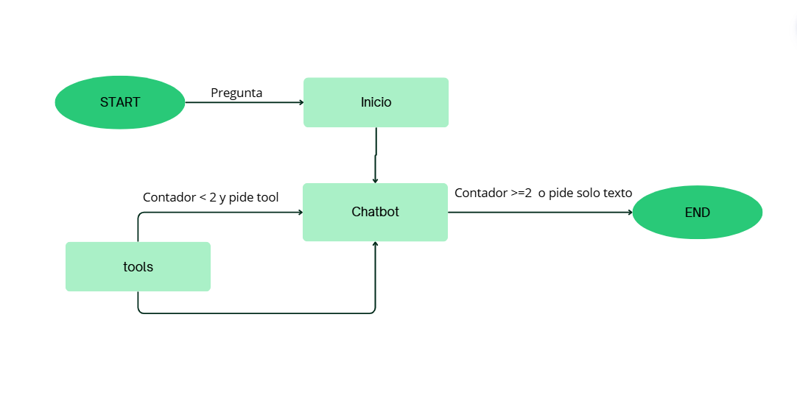

# Asistente de Soporte Técnico Local con LangGraph y Ollama (Llama 3.2)

Este proyecto implementa un asistente de soporte técnico de **solo lectura** utilizando **Python**, **LangGraph** para el control de los flujos del agente, y la Inteligencia Artificial local de **Ollama (Llama 3.2)**. El sistema gestiona consultas mediante estados estructurados, interactúa con herramientas locales validadas sobre bases de datos ficticias y retiene la conversación en disco a través de una base de datos local SQLite.

---

## 📂 Estructura General del Repositorio

El proyecto se encuentra modularizado en los siguientes archivos y carpetas:

```text
LangGraph_chatbot/
├── .env                        
├── soporte_memoria.db           
├── requirements.txt            
├── README.md                   
├─ flujo.png                    
│
├── app/
│   ├── datos/
│   │   └── datos.json          
│   └── soporte/
│       ├── __init__.py          
│       └── tools.py            
│
├── langgraph/                  
│   ├── grafo.py        
│   ├── chatbot.py      
│   
│
└── test/
    └── test.py                  
```

---

## Esquema del Grafo 

El flujo lógico del estado compartido (`State`) se gestiona a través del siguiente circuito de nodos y aristas:



1. **`START`**: Punto de entrada oficial donde el usuario lanza la pregunta.
2. **`Chatbot (Nodo)`**: Invoca al modelo local Llama 3.2 a través de Ollama, el cual analiza el prompt de soporte junto al historial acumulado para generar texto plano o solicitar el uso de una herramienta.
3. Si la IA solicita una herramienta y el contador global de llamadas es menor que el límite establecido, el flujo avanza hacia `Tools`. En caso contrario (respuesta directa o límite alcanzado), desvía el flujo de forma obligatoria a `END`.
4. **`Tools (Nodo)`**: Bloque de Python que ejecuta de forma segura la herramienta seleccionada a través del mapa de funciones, consulta la base de datos local JSON (`datos.json`) y formatea un `ToolMessage` para inyectarlo en el estado.
5. **`END`**: Punto de salida oficial del grafo donde se guarda el estado completo del turno en la base de datos persistente de SQLite.

---

## Matriz de Rutas de Ejecución (Casos de Prueba)

A continuación se detallan los comandos exactos para validar el comportamiento dinámico del agente desde la terminal de PowerShell junto a su flujo lógico interno correspondiente:

| Código de Ruta | Tipo de Entrada | Comando de Prueba en PowerShell | Camino Recorrido en el Grafo | Comportamiento del Agente |
| :--- | :--- | :--- | :--- | :--- |
| **Ruta Directa** | Pregunta Común sin códigos | `python langgraph/chatbot.py --pregunta "Hola, ¿qué servicios ofreces?"` | `START` ➔ `CHATBOT` ➔ `continuar` ➔ `END` | Ollama genera texto directamente. **No se invocan herramientas.** El contador de llamadas se mantiene en `0`. |
| **Ruta con Herramientas** | Pregunta técnica con ID de ticket | `python langgraph/chatbot.py --pregunta "Consulta el estado del ticket T-100"` | `START` ➔ `CHATBOT` ➔ `continuar` ➔ `TOOLS` ➔ `CHATBOT` ➔ `continuar` ➔ `END` | Ollama solicita la herramienta. El sensor valida el contador. **Se abre datos.json**, se extrae el ticket y la IA te responde con los datos reales del soporte. |
| **Ruta con Memoria (Turno 1)** | Registro inicial de contexto local | `python langgraph/chatbot.py --pregunta "Hola, me llamo Erika. Consulta mi ticket T-100" --hilo "chat_aula"` | `START` ➔ `CHATBOT` ➔ `continuar` ➔ `TOOLS` ➔ `CHATBOT` ➔ `continuar` ➔ `END` | La IA extrae los datos del ticket y guarda toda la sesión de mensajes de forma persistente en el archivo SQLite. |
| **Ruta con Memoria (Turno 2)** | Turno secuencial tras reinicio | `python langgraph/chatbot.py --pregunta "¿Te acuerdas de mi nombre?" --hilo "chat_aula"` | `START` ➔ `CHATBOT` ➔ `continuar` ➔ `END` | `graph.get_state` lee el archivo físico `soporte_memoria.db`. **Ollama recupera los mensajes anteriores** y responde recordando que te llamas Erika. |
| **Ruta de Límite (Freno)** | Intento de bucle infinito | `python test/test.py` | `START` ➔ `CHATBOT` ➔ `continuar` (Límite alcanzado) ➔ `END` | **El sensor condicional detecta exceso de llamadas**. Corta el paso hacia las herramientas de inmediato para proteger el sistema y obliga al flujo a terminar en `END`. |
